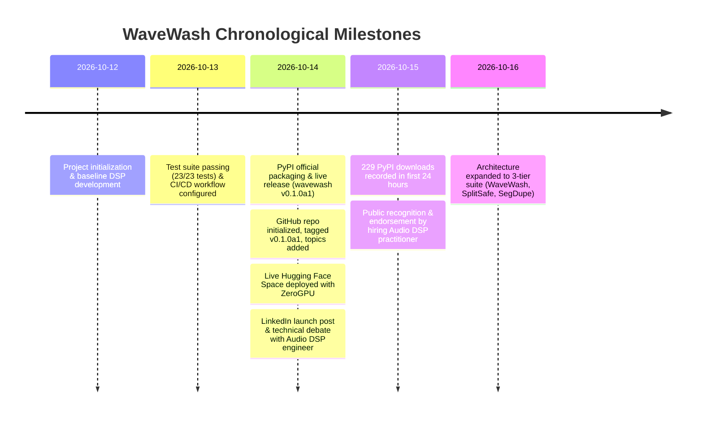

# WaveWash: Master Project Plan, Architecture & Checkpoint Log
**Author:** Boobalan Arjunan (<boobalan.it@gmail.com>)  
**Project:** WaveWash (Audio Quality Control & Data Preparation for Speech/Audio ML)  
**Date Created / Milestone:** October 14–16, 2026  
**Status:** Alpha v0.1.0a1 (Published on PyPI, Deployed on Hugging Face ZeroGPU, Tagged on GitHub)

---

## 1. Executive Summary

WaveWash is an open-source, local-first Python library and web application designed to automate audio dataset quality control, verification, repair, and deduplication for machine learning training (ASR/Whisper, TTS/Voice Cloning, Speaker Identification, and Music Generation). 

Traditional audio dataset curation relies on fragile, one-off scripts or hundreds of hours of manual listening. WaveWash provides a deterministic, mathematically validated Digital Signal Processing (DSP) pipeline combined with an integrated zero-config local Web UI. Original audio files are never modified; clean audio is routed to target folders, while rejected files are segregated into categorized error directories with full audit logging.

---

## 2. Key Links & Production Registries

| Resource | Official Production URL | Status / Metrics |
| :--- | :--- | :--- |
| **PyPI Package** | [https://pypi.org/project/wavewash/](https://pypi.org/project/wavewash/) | **v0.1.0a1 Live** (`pip install wavewash`) |
| **PyPI Download Tracker**| [https://pepy.tech/project/wavewash](https://pepy.tech/project/wavewash) | **229+ total downloads** recorded in first 24h |
| **PyPI Stats API** | [https://pypistats.org/packages/wavewash](https://pypistats.org/packages/wavewash) | 82 direct installs (without mirrors) on Day 1 |
| **GitHub Repository** | [https://github.com/BoobalanArjunan/wavewash](https://github.com/BoobalanArjunan/wavewash) | Branch `main`, Tag `v0.1.0a1`, Active CI/CD |
| **Hugging Face Space** | [https://huggingface.co/spaces/boobalanit/wavewash](https://huggingface.co/spaces/boobalanit/wavewash) | **Running** (Gradio 5 + NVIDIA A10G ZeroGPU) |
| **User Manual** | [docs/WaveWash_User_Manual.pdf](file:///Users/mymac/Desktop/Ai%202026%20Work/Antigravity%20Works/Wavewash/docs/WaveWash_User_Manual.pdf) | Committed in repository |

---

## 3. Core Architecture & DSP Engine

### A. Purpose-Driven Threshold Profiles
WaveWash configures specialized DSP thresholds based on the downstream ML task:
1. **ASR (Automatic Speech Recognition / Whisper):** Moderate noise tolerance (SNR >= 15 dB), max duration 30s, speech ratio >= 0.4.
2. **TTS (Text-to-Speech / Single Speaker):** Studio-clean requirement (SNR >= 28 dB), strict clipping tolerance (0.05%), max RT60 reverb limit 500ms, multi-speaker rejection.
3. **Speaker Recognition / Diarization:** Preserves speaker characteristics, looser SNR (10 dB), speech ratio, max duration 60s.
4. **Music Generation:** Full bandwidth (44.1kHz stereo, 24-bit PCM), crest factor dynamics checking, lossy compression cutoff detection.
5. **Custom Profile:** User-definable parameters via JSON/CLI.

### B. Signal Processing & Repair Algorithms
* **DC Offset Detection & Removal:** Calculates mean displacement per channel; subtracts offsets greater than $10^{-5}$.
* **Clipping Detection & Reconstruction:** Detects peak flatlining within 0.999 threshold; performs cubic spline interpolation across clipped runs up to 8ms.
* **Loudness Normalization:** Conforms audio to EBU R128 integrated loudness standards (default -23.0 LUFS) using `pyloudnorm`.
* **Spectral Cliff Analysis:** Calculates STFT magnitude rolloff and identifies sharp steep cutoff filters (>36 dB/octave) to catch hidden low-bitrate MP3/transcoded files.
* **Acoustic Duplicate & Near-Duplicate Fingerprinting:** Generates spectral energy peak fingerprints and MFCC embeddings to detect identical takes and resampled/re-encoded duplicates without file renaming.
* **Review Sampler:** Automatically samples the most challenging edge cases (highest clipping, lowest SNR) into `_review_sample/` for rapid human auditing.

---

## 4. Software Stack & Interfaces

### A. Python Backend & CLI
* **Language:** Python 3.10+
* **Core Libraries:** `numpy`, `scipy`, `soundfile`, `librosa`, `pyloudnorm`, `scikit-learn`, `tqdm`, `fastapi`, `uvicorn`, `pydantic`.
* **CLI Commands:**
  * `wavewash app [--port 8420]`: Launches the local Web UI on `http://127.0.0.1:8420`.
  * `wavewash run --input <dir> --output <dir> --purpose <asr|tts|speaker_id|music_gen>`: Batch CLI processing.
  * `wavewash doctor`: Diagnoses local environment and optional extras (Silero VAD, Whisper, Matplotlib).

### B. Bundled Local Web Application
* **Frontend:** React + Vite SPA with custom dark UI, folder browsers, preset selectors, and live progress dashboards.
* **Packaging:** Pre-built directly into `src/wavewash/static/`. Shipped inside the PyPI wheel so end users require **no Node.js or npm** to run the app.
* **Security Guard:** Localhost DNS-rebinding and CSRF protection in `server.py` restricting traffic strictly to loopback addresses (`127.0.0.1`, `localhost`).
* **OS Protection:** Explicitly prevents scanning or writing to root and system symlinks (macOS `/private/etc`, Windows system folders).

### C. Hugging Face Space (Cloud Demo)
* **Location:** `huggingface_space/`
* **Framework:** Gradio 5.20.0 with `ssr_mode=False` for zero-configuration cloud hosting.
* **ZeroGPU Integration:** Decorated with `@spaces.GPU` for on-demand NVIDIA A10G acceleration.

---

## 5. Milestone Timeline & Achievements

---

## 6. Peer & Industry Recognition (GTV Evidence Record)

* **Public Engagement:** LinkedIn announcement post generated **213+ impressions** and direct peer commentary within hours.
* **Expert Endorsement:** **Gerald Mwangi** (Audio DSP Engineer & Hiring Manager):
  * Challenged the concept regarding data augmentation vs cleanup.
  * Following Boobalan Arjunan's technical explanation on TTS requirements and baseline normalization, publicly concurred and endorsed the design:  
    > *"Thanks for the clarification. It makes sense: You are generating clean 'label' outputs for audio regression models."*
* **Significance:** Represents verifiable external domain validation from a professional practitioner in audio digital signal processing.

---

## 7. Global Talent Visa (GTV) Evidence Mapping

WaveWash fulfills key requirements for the **Global Talent Visa (UK Tech Nation / US O-1 / Australia GTI)**:

1. **Criterion 1 (Innovation / Significant Contribution Outside Employment):**
   * Independently conceived, architected, and released a specialized audio data quality control engine on the Python Package Index.
   * Documented over 229 downloads and global mirror distributions on Day 1.
2. **Criterion 2 (Recognition & Thought Leadership):**
   * Verifiable public technical debate and endorsement from industry audio engineers.
   * Comprehensive user manual and architecture documentation published under the author's name.
3. **The 3-Tier Audio Curation Suite (The Bigger Picture):**
   * **Tier 1 (File-Level):** `wavewash` — Audio QC, repair, and normalization.
   * **Tier 2 (Split-Level):** `splitsafe` — Train/Validation/Test data leakage and speaker contamination auditor.
   * **Tier 3 (Segment-Level):** `segdupe` — Sub-clip acoustic fingerprinting and landmark constellation sample matching.

---

## 8. Checkpoint Instructions for Antigravity Session Resume

When reopening this project in Antigravity:
1. **Working Directory:** `/Users/mymac/Desktop/Ai 2026 Work/Antigravity Works/Wavewash`
2. **Run Environment:** Python 3.13 (`/opt/miniconda3`), package installed in editable mode (`pip install -e .`).
3. **Run Tests:** `PYTHONPATH=src pytest` (23 tests passing).
4. **Launch Web UI:** `wavewash app` or `python3 -m wavewash.cli app` (runs on `http://127.0.0.1:8420`).
5. **Next Feature Roadmap:**
   * Milestone 1: Wavesurfer.js A/B interactive waveform comparison modal in the React dashboard.
   * Milestone 2: Standalone Tauri desktop packaging (Mac `.dmg` & Windows `.msi`).
   * Milestone 3: DuckDB embedded analytics engine for 100,000+ file datasets.
   * Complementary Tool: Implementation of **SplitSafe** in `/Users/mymac/Desktop/Global Taalent UK/10 Evidences/Splitsafe/splitsafe`.

---
*Document preserved permanently in `/Users/mymac/Desktop/Ai 2026 Work/Antigravity Works/Wavewash/project_plan/PROJECT_SUMMARY_AND_CHECKPOINT.md` and Antigravity system memory.*
